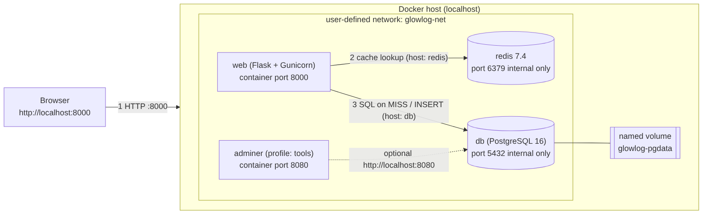
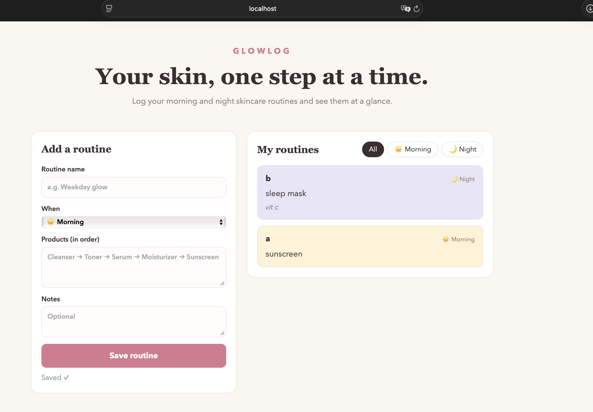
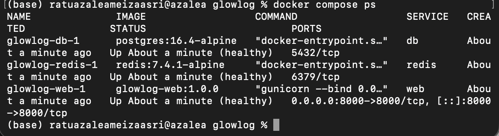
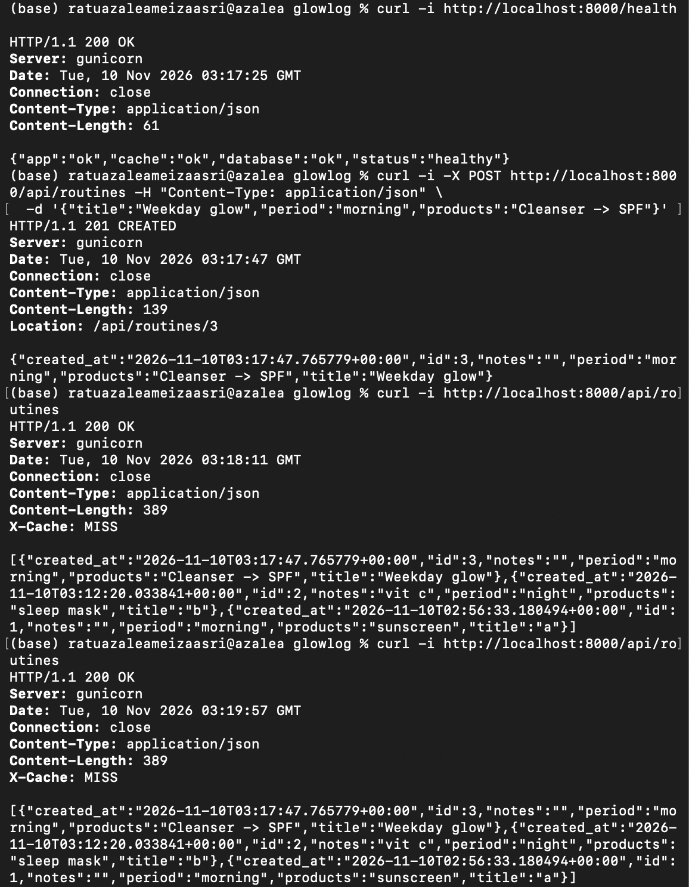
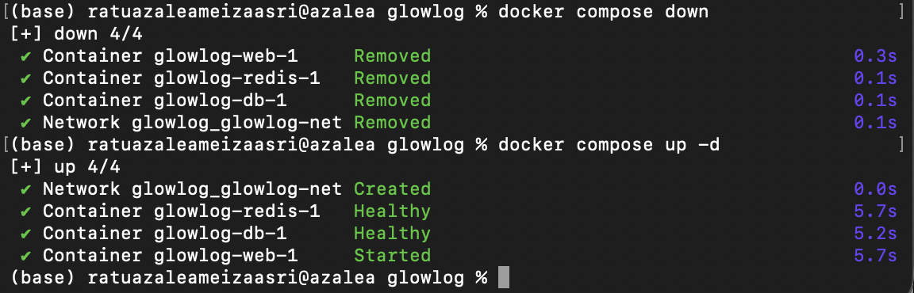

# GlowLog — Skincare Routine Tracker

Aplikasi web multi-tier kecil untuk mencatat produk skincare dan rutinitas **pagi / malam**.
Dibuat untuk UTS Cloud Computing (COMP6991031). Fokusnya adalah **containerization dengan Docker Compose** di localhost.

> **Penulis:** Ratu Azalea Meiza Asri · 2802551254 · 

## Latar Belakang Projek

Skincare routine mudah terlupa, produk mana yang dipakai lebih dulu, dan apakah rutinitas itu untuk pagi atau malam. GlowLog menyediakan tempat sederhana untuk menyimpan rutinitas sebagai daftar produk berurutan dan melihatnya berdasarkan waktu pemakaian.

Saya memilih projek ini karena ukurannya kecil, tetapi tetap memuat semua lapisan yang ingin saya pelajari sebagai Cloud/DevOps Engineer: container aplikasi, database dengan volume, cache, healthcheck, dan konfigurasi lewat environment variable. 

**MVP Feature:** add dan view routines (morning / night).

## Arsitektur



| Container | Image | Port di host | Fungsi |
|-----------|-------|--------------|--------|
| `web` | built from `app/Dockerfile` | `8000` | Flask + Gunicorn (HTML page + API JSON) |
| `db` | `postgres:16.4-alpine` | none (internal) | PostgreSQL with named volume `glowlog-pgdata` |
| `redis` | `redis:7.4.1-alpine` | none (internal) | Cache for `GET /api/routines` (**bonus**) |
| `adminer` | `adminer:4.8.1` | `8080` | UI database, only with `--profile tools` |

Semua container berada di network user-defined `glowlog-net` dan saling terhubung lewat **nama service** (`db`, `redis`).

## Cara menjalankan

Prasyarat: Docker dan Docker Compose v2.

```bash
git clone https://github.com/<USERNAME>/glowlog.git && cd glowlog
cp .env.example .env            # ubah password bila perlu
docker compose up -d --build
```

Buka **http://localhost:8000**.

```bash
docker compose ps                         # semua service running, db dan redis "healthy"
docker compose --profile tools up -d      # jalankan juga Adminer di http://localhost:8080
                                          #   System: PostgreSQL, Server: db, user/password/db dari .env
docker compose down                       # hentikan, data TETAP ada (named volume tetap)
docker compose down -v                    # hentikan dan HAPUS data (volume ikut dihapus)
```

## API

| Method | Path | Sukses | Error |
|--------|------|--------|-------|
| GET | `/health` | `200` (db dan redis ok) | `503` jika ada dependensi yang mati |
| GET | `/api/routines?period=morning\|night` | `200` + daftar JSON, header `X-Cache: HIT/MISS` | `400` bila `period` salah |
| POST | `/api/routines` | `201 Created` + header `Location` | `400` bila validasi gagal |

```bash
curl -i http://localhost:8000/health
curl -i -X POST http://localhost:8000/api/routines \
  -H "Content-Type: application/json" \
  -d '{"title":"Weekday glow","period":"morning","products":"Cleanser -> Serum -> SPF"}'
curl -i http://localhost:8000/api/routines
```

## Redis cache 

`GET /api/routines` memakai pola cache-aside. Panggilan pertama membaca PostgreSQL (`X-Cache: MISS`) lalu menyimpan hasilnya di Redis selama `CACHE_TTL_SECONDS`. Panggilan berikutnya dilayani dari Redis (`X-Cache: HIT`). `POST` yang berhasil menghapus kunci cache agar data tidak basi. Redis punya healthcheck `redis-cli ping`, dan service `web` menunggunya lewat `depends_on: condition: service_healthy`. Jika Redis mati, API tetap berjalan (`X-Cache: BYPASS`).

## Test

```bash
cd app && pip install -r requirements.txt pytest
# butuh PostgreSQL dan Redis yang berjalan; atur DB_HOST, REDIS_HOST, POSTGRES_* sesuai .env
GLOWLOG_SKIP_INIT=1 pytest -q
```

## Security & Data

* `.env` masuk `.gitignore`; yang di-commit hanya `.env.example` (nilai dummy). Tidak ada secret di repositori.
* Hanya data dummy yang dipakai. Aplikasi tidak menyimpan data pribadi (NIK, alamat, nomor telepon).
* Container berjalan sebagai user non-root, dan port database serta Redis tidak dibuka ke host.

## Sources / Credits

* [Flask](https://flask.palletsprojects.com/), [Gunicorn](https://gunicorn.org/), [psycopg2](https://www.psycopg.org/), [redis-py](https://github.com/redis/redis-py): library open-source.
* Image resmi Docker: [postgres](https://hub.docker.com/_/postgres), [redis](https://hub.docker.com/_/redis), [adminer](https://hub.docker.com/_/adminer).

## Screenshot

| App Ui | `docker compose ps` |
|---|---|
|  |  |

| Uji curl (200 / 201) | Persistance test |
|---|---|
|  |  |

## Links

* Artikel: <LINK ARTIKEL>
* Video demo: <LINK YOUTUBE>

## AI Usage Declaration

Selama mengerjakan proses projek ini, saya menggunakan asisten AI (Claude) dalam pengerjaan projek ini untuk:

* membuat konsep ide awal rancangan aplikasi
* membuat kerangka awal kode aplikasi (Flask), Dockerfile, dan docker-compose.yml;
* debugging code selama pengerjaan
* menyusun draf dokumentasi (README, draf artikel, dan kerangka skrip video).


Seluruh keputusan akhir dan isi pengumpulan saya periksa sendiri. Saya bertanggung jawab atas seluruh isi projek ini.