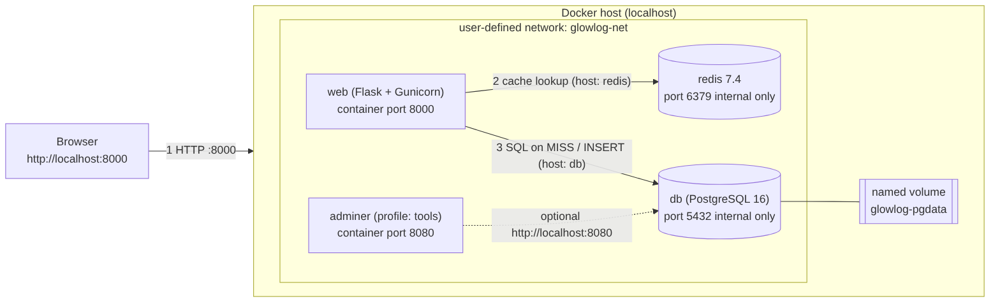

## Identitas

| | |
|---|---|
| **NIM** | `<ISI NIM>` |
| **Nama** | `<ISI NAMA>` |
| **Kelas** | `<ISI KELAS>` |
| **Judul Projek** | GlowLog — Skincare Routine Tracker |

## Tautan

| | |
|---|---|
| **GitHub (Public)** | `<https://github.com/USERNAME/glowlog>` |
| **Artikel** | `<LINK ARTIKEL>` |
| **YouTube (Public)** | `<LINK VIDEO>` |

---

# Jawaban Soal 1 — Analisis Projek & Pemilihan Model Layanan Cloud

## 1a. Profil dan alasan pemilihan projek

**(1) Nama, kategori, masalah, target pengguna.** Projek saya bernama **GlowLog**, kategori **Web**. GlowLog menyelesaikan masalah orang yang sulit mengingat urutan dan jadwal produk skincare: mana yang dipakai pagi, mana yang malam, dan urutan pemakaiannya. Target penggunanya adalah mahasiswa dan dewasa muda pengguna skincare yang ingin pencatatan sederhana tanpa aplikasi berat.

**(2) Fitur inti (MVP).** Menambah dan melihat rutinitas skincare. Setiap rutinitas punya nama, waktu (pagi/malam), daftar produk berurutan, dan catatan. Daftar dapat difilter pagi atau malam.

**(3) Alasan memilih.** Skala projeknya kecil sehingga selesai dalam waktu ujian, tetapi tetap memuat semua lapisan yang ingin saya kuasai: container aplikasi, database stateful dengan volume, cache, healthcheck, dan konfigurasi lewat environment variable. Saya tertarik pada peran **Cloud/DevOps Engineer**, dan pola ini (aplikasi + database + cache yang dikemas dalam container) sama dengan pola yang dipakai tim DevOps pada aplikasi produksi. `<Tambahkan 1–2 kalimat motivasi pribadi Anda, misalnya pengalaman memakai skincare.>`

**(4) Requirement.**

* **Teknis:** Python 3.12 + Flask (frontend template dan backend satu container), PostgreSQL 16 (database), Redis 7 (cache), Docker dan Docker Compose v2.
* **Biaya:** target **Rp0**. Seluruh perangkat lunak open-source dan berjalan di localhost. Bila kelak di-deploy, saya memakai free tier penyedia cloud (batas kuota/waktu perlu diperiksa saat itu).
* **Kepatuhan:** data yang disimpan hanya nama rutinitas, nama produk, dan catatan, yaitu data dummy tanpa identitas orang, sehingga bukan data pribadi. Jika kelak ditambah akun (nama/email) maka itu menjadi data pribadi dan harus mengikuti **UU No. 27 Tahun 2022 tentang Pelindungan Data Pribadi**: persetujuan pengguna, minimisasi data, dan keamanan penyimpanan. Catatan kondisi kulit bisa mengarah ke data kesehatan (data pribadi yang bersifat spesifik), jadi tidak saya minta di MVP.
* **Karakteristik esensial cloud (NIST) yang paling dibutuhkan: *Measured service*.** Karena target biaya Rp0/free tier, penggunaan resource (CPU, memori, storage, request) harus terukur agar tidak melewati kuota gratis.

## 1b. Perbandingan lima model layanan

| Model | Tingkat abstraksi | Dikelola Anda | Dikelola penyedia | Contoh penyedia | Cocok untuk GlowLog? |
|---|---|---|---|---|---|
| **IaaS** | Terendah (infrastruktur mentah) | OS, runtime, aplikasi, data, patching | Server fisik, virtualisasi, storage, jaringan | AWS EC2 | Kurang cocok: terlalu banyak yang harus diurus (OS, patch) untuk aplikasi sekecil ini. |
| **PaaS** | Menengah (platform) | Kode aplikasi, konfigurasi, data | OS, runtime, scaling, infrastruktur | Google App Engine / Render | **Cocok**: cukup unggah kode atau container, tanpa mengurus server. |
| **SaaS** | Tertinggi (aplikasi jadi) | Hanya penggunaan dan data akun | Seluruh aplikasi dan infrastrukturnya | Google Workspace | Tidak cocok: GlowLog itu sendiri yang saya bangun, bukan aplikasi jadi yang dipakai. |
| **BaaS** | Tinggi (backend siap pakai: auth, DB, storage via API) | Frontend dan aturan akses | Backend, database, autentikasi | Supabase / Firebase | Cocok sebagai alternatif (database + auth siap pakai), tetapi menyembunyikan Docker yang ingin saya pelajari. |
| **FaaS** | Tinggi (fungsi per event) | Kode fungsi | Server, scaling, eksekusi | AWS Lambda | Kurang cocok: butuh koneksi DB yang persisten dan rentan *cold start* untuk web yang selalu aktif. |

## 1c. Model deployment dan rekomendasi

**Perbedaan model deployment.**

* **Public cloud:** infrastruktur dimiliki dan dioperasikan penyedia, dipakai bersama banyak pelanggan (AWS, GCP, Azure). Murah dan cepat, tetapi kontrol terbatas.
* **Private cloud:** infrastruktur khusus untuk satu organisasi (on-premise atau dedicated). Kontrol dan isolasi tinggi, biaya dan operasional lebih besar.
* **Hybrid cloud:** gabungan private dan public yang terhubung. Misalnya data sensitif di private, beban puncak di public.
* **Multi-cloud:** memakai lebih dari satu penyedia public (mis. AWS + GCP) untuk menghindari ketergantungan satu vendor atau memilih layanan terbaik.

**Rekomendasi untuk GlowLog: PaaS (container) + Public cloud.** Saya akan men-deploy image Docker ke platform PaaS di public cloud dan memakai database PostgreSQL terkelola (managed).

* **Teknis:** PaaS mengurus OS, runtime, TLS, dan scaling, sehingga saya fokus ke kode. Aplikasi sudah berupa container sehingga langsung bisa berjalan.
* **Biaya:** mulai dari **free tier** (Rp0) saat prototipe. Jika traffic naik beralih ke **pay-as-you-go**. *Reserved* atau *spot instance* tidak perlu karena beban kecil dan tidak stabil; *spot* juga bisa diinterupsi sehingga tidak cocok untuk database.
* **Kepatuhan:** data dummy tanpa data pribadi, sehingga public cloud aman. Bila nanti menyimpan data pribadi, pilih region yang sesuai dan terapkan kontrol UU PDP (enkripsi, akses terbatas, persetujuan pengguna). Private/hybrid baru dipertimbangkan untuk data yang sangat sensitif.

**Dua trade-off.**

1. **Batas free tier dan cold start:** layanan gratis sering dibatasi kuota/waktu dan "tidur" saat idle, sehingga request pertama lambat. Solusinya memantau penggunaan (measured service) dan beralih ke pay-as-you-go bila perlu.
2. **Vendor lock-in:** memakai fitur khusus satu PaaS membuat migrasi sulit. Mitigasinya: tetap memakai container standar dan konfigurasi lewat environment variable.

**Bagaimana Docker memudahkan perpindahan.** Image Docker membungkus aplikasi beserta dependensinya, sehingga "jalan di laptop" sama dengan "jalan di cloud". Perpindahan dari localhost ke cloud cukup `docker push` image ke registry lalu menjalankannya di platform mana pun yang mendukung container; konfigurasi (alamat DB, password) diganti lewat environment variable tanpa mengubah kode, dan pindah vendor tidak perlu menulis ulang aplikasi.

---

# Jawaban Soal 2 — Aplikasi Multi-Tier dengan Docker Compose

## 2a. Desain arsitektur

{width=100%}

**Container, port, network, volume.**

| Container | Port ke localhost | Network | Volume |
|---|---|---|---|
| `web` (Flask + Gunicorn) | `8000` → 8000 | `glowlog-net` | tidak ada |
| `db` (PostgreSQL 16) | tidak dibuka (internal 5432) | `glowlog-net` | `glowlog-pgdata` (named volume) |
| `redis` (Redis 7.4) | tidak dibuka (internal 6379) | `glowlog-net` | tidak ada (cache sementara) |
| `adminer` (profile `tools`) | `8080` → 8080 | `glowlog-net` | tidak ada |

**Alur request:** Browser → `http://localhost:8000` → container `web` → (1) cek cache ke `redis` (nama service `redis`) → bila *MISS*, (2) query ke `db` (nama service `db`) → hasil disimpan ke Redis → respons JSON/HTML kembali ke browser. Untuk `POST`, `web` menulis ke `db` lalu menghapus cache.

**Mengapa container lebih tepat daripada virtual machine.**

* **Namespaces dan cgroups:** container hanyalah proses Linux biasa yang diisolasi oleh *namespaces* (PID, network, mount, dll.) dan dibatasi oleh *cgroups* (CPU, memori). Container berbagi kernel host, sedangkan VM menjalankan sistem operasi tamu lengkap beserta kernelnya di atas hypervisor.
* **Ukuran:** image container hanya berisi aplikasi dan dependensinya (puluhan hingga ratusan MB), sedangkan VM berisi seluruh OS (beberapa GB).
* **Waktu startup:** container mulai dalam hitungan detik (tidak perlu boot OS), VM butuh puluhan detik hingga menit.
* Untuk GlowLog yang kecil dengan tiga service, container lebih ringan, cepat dinyalakan ulang, dan mudah direproduksi oleh orang lain dengan satu perintah.

## 2b. Dockerfile

Berkas: `app/Dockerfile` (lengkap di repositori). Berikut pemenuhan setiap persyaratan:

```dockerfile
FROM python:3.12.7-slim-bookworm AS builder      # (1) stage 1 "builder"; (2) tag versi spesifik
WORKDIR /build                                    # (4) WORKDIR
ENV PIP_NO_CACHE_DIR=1 PIP_DISABLE_PIP_VERSION_CHECK=1   # (4) ENV
COPY requirements.txt .                           # (3) dependency dulu, (5) COPY
RUN pip install --prefix=/install -r requirements.txt

FROM python:3.12.7-slim-bookworm AS runtime       # (1) stage 2 "runtime"
ENV PYTHONUNBUFFERED=1 PYTHONDONTWRITEBYTECODE=1 PORT=8000
WORKDIR /app
RUN useradd --system --no-create-home --uid 10001 glowlog   # user non-root
COPY --from=builder /install /usr/local           # hanya paket hasil build
COPY --chown=glowlog:glowlog . .                  # (3) source code SETELAH dependency
USER glowlog
EXPOSE 8000                                       # (4) EXPOSE
HEALTHCHECK ... CMD ["python","-c","...urlopen('http://127.0.0.1:8000/health')..."]
CMD ["gunicorn","--bind","0.0.0.0:8000","--workers","2","--access-logfile","-","app:app"]   # (4) exec form
```

1. **Multi-stage:** stage `builder` memasang dependensi; stage `runtime` hanya menyalin hasil instalasi (`/install`) dari builder. Alat dan cache pemasangan tidak ikut ke image akhir, sehingga **image tetap kecil** dan permukaan serangan lebih sedikit.
2. **Tag versi spesifik:** `python:3.12.7-slim-bookworm` (bukan `latest`) agar build dapat direproduksi dan tidak berubah diam-diam.
3. **Dependency sebelum source:** `requirements.txt` disalin dan di-install lebih dulu. Selama file itu tidak berubah, layer instalasi dipakai ulang dari cache, jadi mengubah kode tidak memicu `pip install` ulang.
4. **WORKDIR, ENV, EXPOSE, CMD exec form:** `WORKDIR` menentukan direktori kerja; `ENV` mengatur variabel; `EXPOSE 8000` mendokumentasikan port; `CMD ["gunicorn", ...]` memakai exec form sehingga gunicorn menjadi PID 1 dan menerima sinyal `SIGTERM` langsung (shutdown bersih saat `docker compose down`). Bentuk *shell form* menjalankan lewat `/bin/sh -c` dan sinyal tidak diteruskan.
5. **COPY vs ADD:** `COPY` hanya menyalin berkas lokal ke image, perilakunya jelas dan dapat diprediksi. `ADD` punya kemampuan tambahan (mengunduh URL dan mengekstrak tar otomatis) yang bisa mengejutkan dan mengurangi keamanan. Karena tidak ada kebutuhan itu, saya memakai `COPY`.
6. **`.dockerignore`** (`app/.dockerignore`) mengecualikan `.git`, `.env`, `__pycache__`, `tests/` agar konteks build kecil dan **secret tidak ikut masuk image**.

**Ukuran image:**

```text
<TEMPEL OUTPUT: docker images glowlog-web>
```

Multi-stage menjaga image kecil karena image akhir berasal dari base `slim` dan hanya memuat paket Python yang dibutuhkan; compiler, cache pip, dan file sementara ada di stage builder yang dibuang.

## 2c. Docker Compose

Berkas: `docker-compose.yml` (lengkap di repositori).

1. **≥ 2 service:** `web` (aplikasi) dan `db` (PostgreSQL), plus `redis` dan `adminer`.
2. **User-defined network:** semua service memakai `glowlog-net`. Aplikasi terhubung memakai `DB_HOST: db` dan `REDIS_HOST: redis` (nama service, bukan IP/localhost); DNS internal Docker menerjemahkannya.
3. **Named volume:** `glowlog-pgdata:/var/lib/postgresql/data` menyimpan data PostgreSQL di luar siklus hidup container.
4. **Healthcheck + `depends_on` condition:** `db` memakai `pg_isready -U $${POSTGRES_USER} -d $${POSTGRES_DB}` (`$$` agar tidak diinterpolasi Compose); `web` memakai `depends_on: db: condition: service_healthy` (dan juga untuk `redis`), jadi aplikasi baru start setelah database benar-benar siap.
5. **`.env`:** `env_file: .env` dan `${APP_PORT:-8000}`. Yang di-commit hanya `.env.example`; `.env` ada di `.gitignore`.
6. **Profile:** `adminer` memakai `profiles: ["tools"]`, hanya jalan dengan `docker compose --profile tools up -d`.

Aplikasi berjalan dengan satu perintah `docker compose up -d --build` dan dibuka di `http://localhost:8000`.

**Bonus (Redis cache, +5):** service `redis` punya `healthcheck: redis-cli ping` dan benar-benar dipakai aplikasi: `GET /api/routines` memakai pola cache-aside (header `X-Cache: MISS` lalu `HIT`), cache dihapus saat `POST`.

## 2d. Bukti berjalan di localhost

> Sisipkan screenshot Anda sendiri di bawah setiap butir.

**(1) `docker compose ps`** — semua service `running`, `db` dan `redis` berstatus `healthy`.

`<SCREENSHOT 1>`

**(2) Uji endpoint dengan curl** (status code 200 dan 201, serta 400 untuk input tidak valid):

```bash
curl -i http://localhost:8000/health                     # 200 OK
curl -i -X POST http://localhost:8000/api/routines \
  -H "Content-Type: application/json" \
  -d '{"title":"Weekday glow","period":"morning","products":"Cleanser -> SPF"}'   # 201 Created
curl -i -X POST http://localhost:8000/api/routines \
  -H "Content-Type: application/json" -d '{"title":"","period":"noon"}'            # 400 Bad Request
curl -i http://localhost:8000/api/routines               # 200 OK, X-Cache: MISS
curl -i http://localhost:8000/api/routines               # 200 OK, X-Cache: HIT
```

`<SCREENSHOT 2>`

**(3) Uji persistensi:** tambah data → `docker compose down` → `docker compose up -d` → data masih ada.

`<SCREENSHOT 3>`

**Perbedaan `down` dan `down -v`:** `docker compose down` menghapus container dan network tetapi **mempertahankan named volume**, sehingga data tetap ada saat `up` lagi. `docker compose down -v` juga **menghapus named volume**, sehingga data database hilang dan database mulai kosong lagi.

## 2e. Push ke GitHub

Repositori: `<https://github.com/USERNAME/glowlog>` (Public). Berisi README (deskripsi dan alasan, cara menjalankan, screenshot, tautan artikel dan video, AI Usage Declaration), riwayat commit bertahap dengan pesan bermakna (lebih dari 5 commit), dan tanpa secret (`.env` di `.gitignore`, `.env.example` tersedia). Orang lain cukup `git clone`, `cp .env.example .env`, lalu `docker compose up -d --build`.

## 2f. Video demo YouTube

Tautan: `<LINK VIDEO>` (Public, 3–5 menit, narasi suara sendiri, berisi perkenalan projek, penjelasan Dockerfile dan docker-compose.yml, serta demo di localhost termasuk uji persistensi).

## 2g. Artikel publik

Tautan: `<LINK ARTIKEL>` (500–800 kata, memuat masalah dan alasan, arsitektur, potongan Dockerfile dan docker-compose.yml, cara menjalankan, screenshot, pelajaran, serta tautan GitHub dan YouTube).

## Bonus yang dipilih

**Service cache Redis (+5):** `redis:7.4.1-alpine` dengan healthcheck `redis-cli ping`, dipakai aplikasi untuk cache `GET /api/routines` dan dibersihkan saat data baru ditulis.
