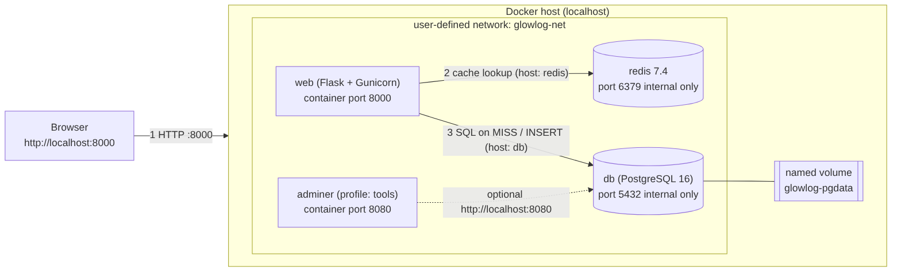

# Containerizing a Skincare Tracker: A Three-Tier App with Docker Compose

*Replace the bracketed placeholders (`[...]`) with your own details before publishing.*

## The problem and why I chose it

I wanted to practice real DevOps skills on something small enough to finish quickly. Skincare routines turned out to be a perfect fit: people forget which product goes first, or whether a routine is for morning or night. So I built **GlowLog**, a tiny web app where you save a routine as an ordered list of products and view it by morning or night. [Add one sentence on your personal motivation.]

The feature set is deliberately tiny (add and view routines). The goal of this project was not features. It was **containerization**: getting a web app, a database and a cache to run together on localhost with a single command.

## Architecture



GlowLog has three tiers, each in its own container, all on one user-defined Docker network:

- **web**: Flask + Gunicorn, serving the HTML page and a JSON API.
- **db**: PostgreSQL 16 with a **named volume**, so data survives container restarts.
- **redis**: a cache for the read endpoint.

The app reaches the others by **service name** (`db`, `redis`), not by IP address or `localhost`. Docker's built-in DNS handles that. Only port `8000` is published to the host; the database and cache stay private.

The API follows proper HTTP semantics: `GET /health` returns `200` (or `503` if a dependency is down), `GET /api/routines` returns `200`, and `POST /api/routines` returns `201 Created` with a `Location` header, or `400` for invalid input.

## The Dockerfile

The Dockerfile uses a **multi-stage build**. The first stage installs dependencies; the second copies only the installed packages into a clean slim image.

```dockerfile
FROM python:3.12.7-slim-bookworm AS builder
WORKDIR /build
COPY requirements.txt .
RUN pip install --prefix=/install -r requirements.txt

FROM python:3.12.7-slim-bookworm AS runtime
WORKDIR /app
RUN useradd --system --no-create-home --uid 10001 glowlog
COPY --from=builder /install /usr/local
COPY --chown=glowlog:glowlog . .
USER glowlog
EXPOSE 8000
CMD ["gunicorn", "--bind", "0.0.0.0:8000", "--workers", "2", "app:app"]
```

A few choices worth explaining:

- **Pinned base image tag** (not `latest`), so builds are reproducible.
- **`requirements.txt` is copied before the source code.** Docker caches layers, so editing code does not re-run `pip install`.
- **`COPY` instead of `ADD`**, because I don't need URL downloads or auto-extraction, and `COPY` is more predictable.
- **Exec-form `CMD`**, so Gunicorn is PID 1 and receives `SIGTERM` directly for clean shutdowns.
- **A non-root user** and a `.dockerignore` that keeps `.env` and `.git` out of the image.

## docker-compose.yml

```yaml
services:
  web:
    build: ./app
    env_file: .env
    environment: { DB_HOST: db, REDIS_HOST: redis }
    ports: ["${APP_PORT:-8000}:8000"]
    depends_on:
      db:    { condition: service_healthy }
      redis: { condition: service_healthy }
    networks: [glowlog-net]
  db:
    image: postgres:16.4-alpine
    env_file: .env
    volumes: [glowlog-pgdata:/var/lib/postgresql/data]
    healthcheck:
      test: ["CMD-SHELL", "pg_isready -U $${POSTGRES_USER} -d $${POSTGRES_DB}"]
```

The key idea is `depends_on` with `condition: service_healthy`. Plain `depends_on` only waits for a container to *start*, not for PostgreSQL to be *ready*. With a healthcheck (`pg_isready`), the app only starts once the database accepts connections. Configuration comes from a `.env` file that is git-ignored; only `.env.example` is committed. An optional Adminer container sits behind a Compose **profile** and only starts with `--profile tools`.

## The Redis cache

For the bonus, `GET /api/routines` uses a cache-aside pattern. The first request reads PostgreSQL and responds with `X-Cache: MISS`. The next requests are served from Redis with `X-Cache: HIT`. A successful `POST` deletes the cached key, so users never see stale data. If Redis goes down, the API still works by falling back to the database.

## Run it yourself

```bash
git clone [your-repo-url] glowlog && cd glowlog
cp .env.example .env
docker compose up -d --build
```

Then open `http://localhost:8000`.

[Insert screenshots: the app UI, `docker compose ps` showing healthy services, and curl output with 200 and 201.]

To prove persistence, I added a routine, ran `docker compose down`, then `docker compose up -d`, and the data was still there. `docker compose down -v` also removes the volume and wipes the data.

## What I learned

1. **Healthchecks matter more than start order.** Most "connection refused" bugs at startup disappear once the app waits for a healthy database.
2. **Layer order controls build speed.** Putting dependencies before source code made rebuilds much faster.
3. **Multi-stage builds keep images small and safer**, since build tools never reach the runtime image.
4. **Containers make the move to the cloud straightforward.** The same image can be pushed to a registry and run on a container platform, with only environment variables changing.

## Links

- GitHub: [repo link]
- YouTube demo: [video link]
